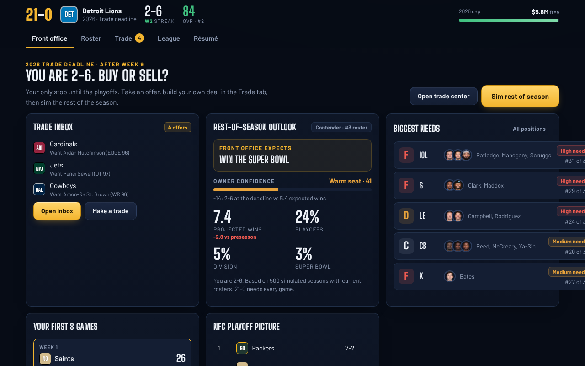

<p align="center"></p>

<h1 align="center">21-0</h1>

<p align="center">A pro football front-office game. Take over any team as it stood at Week 1 of 2026 and build the first team to go 21-0: 17-0 in the regular season, then four playoff wins.</p>

<p align="center"> </p>

## How a run works

| Phase | What you do |
|---|---|
| **2026, first half** | Plays out with the team's real roster. No moves. |
| **Week 9 deadline** | Your one stop: take offers from your inbox or build your own trades. |
| **Playoffs** | 8 teams per conference and no byes, so 21-0 is possible. Watch round by round or skip ahead. |
| **2027 offseason** | Progression and regression, re-sign negotiations, three free-agency waves, the 2027 draft, and the cut to 53. |
| **2027 season** | One more deadline and one more shot. |
| **The end** | A rebuild report card, season awards, your GM résumé and a share card. |

## What's inside

- **Real starting point.** 2026 rosters, contracts and cap hits. Ratings come from 2023–26 production, playing time, contracts and draft pedigree, so one bad year doesn't erase a career.
- **A trade market calibrated on real deals.** Values were fitted to the last 1,000 trades (2013–2026): the pick chart from 375 pick-for-pick swaps, future picks worth about 60% of the same slot, and star prices matching what Tyreek Hill, Davante Adams and Jalen Ramsey actually fetched. Each team also weighs its own situation, needs, GM style, scouting, cap room and division rivalries.
- **Offers come to you.** At least three every trade window, plus draft-day calls to trade up into your pick. Teams counter instead of just saying no.
- **Free agency with people in it.** Players care about money, winning, role and loyalty in different amounts. Meet them, pitch them, make offers, then see whether a rival outbids you and decide whether to match.
- **The real 2027 draft class**, with scouting ranges that can be wrong. Every pick's true rating is revealed on the spot: steal, as projected, or bust.
- **Seasons that feel alive.** Hidden form drives breakout years and slumps, injuries happen, owner confidence rises and falls, and awards are handed out at the end.
- **A game model tuned to the real league.** Team wins spread like they do in the NFL (best record usually 13 to 15 wins). Position value follows real analytics: the quarterback explains about 30% of the gap between teams, so an elite QB is worth about +5 wins and a star running back well under one. Every player card and trade shows what a move is worth in wins.
- **21-0 is a moonshot, not a lottery.** A team as it stands has about a 1 in 20,000 shot. A well-built team has about 1%, and a true superteam about 3%. Any given Sunday still applies.
- **Challenge modes:** No trades, Cap hell, and Worst to first.
- **Built for phones.** A bottom tab bar with one big Next button, plus installable to your home screen.

## Controls

| Key | Action |
|---|---|
| `N` | Do the next step (sim, play the next round, end the wave...) |
| `1`–`5` | Front office, Roster, Trade, League, Résumé |
| `Esc` | Close a pop-up or menu |

On a phone, the gold ▶ button in the middle of the tab bar always does the next step.

## Run it locally

It's a static site with no build step and no dependencies.

```bash
npm run dev
```

Then open http://localhost:8000. Opening `index.html` straight from disk won't load the data files.

## Tests

```bash
npm test
```

They play the engine end to end: a full 2026 season, trade-value sanity checks, AI offer fairness, the whole offseason, a 2027 season and the final report. GitHub Actions runs them on every push.

## Project layout

| Path | What it is |
|---|---|
| `index.html` | Page shell and every style |
| `engine.js` | Game engine: ratings, trade values, the sim, offseason, draft, free agency, awards |
| `app.js` | Interface |
| `data.json` | Rosters, contracts, ratings, potential, production, hype, schedule and 2027 prospects |
| `heads.json`, `img/` | Player headshot sprite sheets, one per team |
| `tests/` | Engine tests (`node --test`) |
| `tools/` | Scripts that built the ratings, headshots and trade research, plus a local server |

## Data and credits

- Rosters, stats, snap counts, draft history and trades: [nflverse](https://github.com/nflverse/nflverse-data), licensed CC BY 4.0.
- Player headshots: NFL.com images, matched through nflverse player IDs.

## Legal

21-0 is an unofficial fan project. It is not affiliated with, endorsed by or licensed by the National Football League, the NFL Players Association or any team. Team names, player names and player photos are the property of their respective owners. Ratings, trade values and results are simulated estimates.
