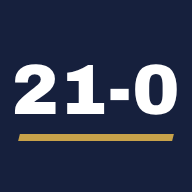
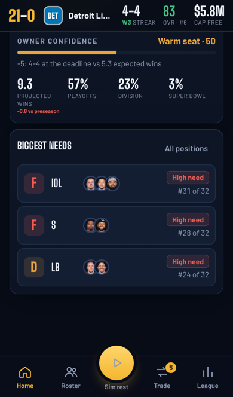

<p align="center"></p>

<h1 align="center">21-0: Run the Front Office</h1>

<p align="center">A pro football front-office game. Take over any team as it stood at Week 1 of 2026 and build the first team to go 21-0: 17-0 in the regular season, then four playoff wins.</p>

<p align="center"> </p>

## How a run works

| Phase | What you do |
|---|---|
| **2026, first half** | Plays out with the team's real roster. No moves. |
| **Week 9 deadline** | Your one stop: take offers from your inbox or build your own trades. |
| **Playoffs** | 8 teams per conference and no byes, so 21-0 is possible. Watch round by round or skip ahead. |
| **2027 offseason** | Re-sign negotiations, three free-agency waves, the 2027 draft, training camp (where every player's offseason growth or decline shows, and rookies' real ratings come out), and the cut to 53. |
| **2027 season** | One more deadline and one more shot. |
| **The end** | A rebuild report card, season awards, your GM résumé and a share card. |

## What's inside

- **Real starting point.** 2026 rosters, contracts and cap hits. Ratings work like Madden's. They draw on box scores, efficiency, advanced and Next Gen stats since 2019, snap share, contracts, draft pedigree and age curves, plus winning and playoff success for quarterbacks. Every player also has Madden-style attributes, such as a QB's accuracy, arm, decisions, poise and mobility, or a corner's coverage, ball skills and tackling. Linemen are graded on how their line blocked while they were on the field. Attributes decide the matchups in every game: pass game against pass defense, run game against run defense.
- **Games played snap by snap.** Every game is simulated play by play: downs, distance, the clock, the two-minute drill and overtime. Each coach calls plays from his own tendencies, and every snap pits the players on the field against each other: accuracy against coverage, pass rush against pass blocking, run blocking against run defense. Weather, home field, momentum and the locker room matter. Box scores, scoring plays and season stats come straight from the plays, calibrated to NFL averages.
- **A trade market that thinks.** Every team values a player through its own eyes. It weighs his talent, position, age, contract surplus and whether he would start for them. It also weighs how much a win matters to them right now, whether his best years line up with their window, and whether they are already deep at his spot. They count the roster spots a deal costs them, remember how your last deals with them went, and read the draft with their own value chart.
- **A living league.** AI teams trade with each other all year, with a rush at the deadline and a wave in the offseason. Put a player on your block and start a bidding war. Prices climb as the deadline nears.
- **Contracts that matter in trades.** No-trade clauses, stars who want an extension before they come, dead money when you move a player, restructures for cap room, and a one-tap "take back salary" when their cap is the problem.
- **GMs who negotiate.** They ask for your players by name, propose pick swaps, conditional picks that upgrade if they make the playoffs, and top-10 protected firsts.
- **A trade market calibrated on real deals.** Values were fitted to the last 1,000 trades (2013–2026): the pick chart from 375 pick-for-pick swaps, future picks worth about 60% of the same slot, and star prices matching what Tyreek Hill, Davante Adams and Jalen Ramsey actually fetched. Each team also weighs its own situation, needs, GM style, scouting, cap room and division rivalries.
- **Trading like a front office.** Offers come to you every window. Put players on your trade block and teams bid. Build a trade from a grid of teams that shows who wants your players, filter by position, and see every deal's value in wins. Ask around on any player for what teams would give. Seven-round picks, so role players move for late picks.
- **Trade calls.** Pitch a deal on the phone and negotiate. Every GM opens above fair value, and a bar shows your offer against their price. Every answer comes with their reasons, and the price comes down as you talk. Sweeten it, take something off, meet in the middle, ask who else they would move, bluff, or walk away. Each GM's temperament changes how the call goes.
- **Free agency with people in it.** Players care about money, winning, role and loyalty in different amounts. Every offer gets an answer right away: yes, a counter you can accept, or no. Pitch them to raise their interest, and hear about anyone you talked to who signs elsewhere.
- **Trade for anyone.** Search the league by name or position and trade for a player straight from the list. Every deal, offer and call has an × on each piece to take it out.
- **Position flexibility.** Move a tackle to guard or a corner to safety in the depth chart, a few points worse than at his own spot.
- **Talk to coach.** Open a young backup's card and work him in: start him now, phase him in over four games, give him spot drives, or keep the starter and showcase him for a trade. The coach has his own read and pushes back when he disagrees. Playing time speeds up the young player's growth; a benched veteran costs some locker room chemistry, and teams offer less for a starter you are moving on from.
- **Player development.** Young players climb steadily on age and upside, not just one season's stats; veterans stay relevant into their early 30s before the decline. Players change during the season too: hot and cold streaks come and go, young starters pick up points as they play, and a hot young player can break out mid-season (about a dozen a year league-wide).
- **The real 2027 draft class**, with scouting ranges that can be wrong. Rookies carry only the scouts' range until training camp is over; their real ratings come out at training camp: ahead of schedule, on track, or needs time.
- **Real future classes.** The 2028, 2029 and 2030 drafts are headlined by today's top college sophomores, college freshmen and high school seniors from the national recruiting rankings, mixed into full boards where a recruiting rank is no promise. Below them, about 6,000 real players from the 2026 college rosters enter the draft when a model says they would. Starters on contenders leave early. Backups on stacked rosters wait their turn. Players hurt in 2026, or redshirting, stay longer. Each prospect's card shows his path. Play long enough and a few legends show up on the big board.
- **A draft room.** The big board marks where your pick falls, with your needs and depth chart beside it. Rookies are judged after camp as ahead of schedule, on track or needing time, never written off before they play.
- **Fifth-year options and captains.** Keep a first-round pick a fifth year at a set price, and name an offense and a defense captain who steady the locker room.
- **Offers you can always take.** Accept, Decline or Counter: if a deal needs cap room, Accept makes it and says who goes. While you counter, their original offer stays on the table.
- **Draft-day trades by pick or by team.** Every upcoming pick is priced on the draft chart, so moving up or down is one tap from the ticker, the draft order or the Trades tab, without leaving the draft.
- **Seasons that feel alive.** Hidden form drives breakout years and slumps, injuries happen, owner confidence rises and falls, and awards are handed out at the end.
- **Season goals.** Every season sets three goals on top of the owner's, picked for your team: win a set number of games, take the division, sweep a rival, a top-10 offense or defense, a winning streak. Each one you hit raises the owner's confidence and counts on your final report.
- **Locker room.** Chemistry rises with wins and drops when you trade away or cut players the room trusts, veterans most of all. A tight room is worth up to two points a game, and every trade shows what it will cost before you make it.
- **Offers that make sense.** At most three at a time, all close to fair. Each one says what it does to your wins this season, and only one will ask you to give up a starter for later.
- **Trades that look right.** A star never moves for spare parts, even when the values add up: the return needs a player close to his level, or a first-round pick and a strong second piece. When a deal can't happen, the game says why.
- **A trade deadline you can't miss.** Trades are open every week until the deadline after Week 9, with a countdown, a deadline-day banner and a last-chance warning. Free agents can be signed any week of the season.
- **Know your next opponent.** Win odds, the matchup to watch, the one to lean on, and a game plan that links straight to the upgrade that would help.
- **Needs everywhere.** Home shows your biggest holes with who starts there and who is next up. The trade builder shows your needs on your side and theirs on theirs. Shopping lists have a My needs filter. The lineup shows the whole bench.
- **A game model tuned to the real league.** Team wins spread like they do in the NFL (best record usually 13 to 15 wins). Position value follows real analytics: the quarterback explains about 30% of the gap between teams, so an elite QB is worth about +5 wins and a star running back well under one. Every player card and trade shows what a move is worth in wins.
- **21-0 is a moonshot, not a lottery.** A team as it stands has about a 1 in 20,000 shot. A well-built team has about 1%, and a true superteam about 3%. Any given Sunday still applies.
- **Worst to first:** an optional mode limited to the 8 worst rosters.
- **Real contracts.** Lengths and salaries come from OverTheCap: this season's cap hit now, then each deal's real average from next season. The cap is the real $301.2M for 2026 and $327M for 2027, then grows about 7% a year.
- **Keep playing.** The scored run is 2026 and 2027, but after the final report you can keep going: a new offseason, a new draft class and a new season every year. Players age, retire and get replaced by drafted and undrafted rookies, so the league stays near the real average age of about 26.
- **Scout ahead.** The next draft class is in League › More, well before draft day.
- **Box scores for every game.** Tap any result for passing, rushing, receiving, defense and kicking lines and a player of the game. Season stats (completions, carries, targets, tackles, pass breakups, field goals) are built play by play and land in real NFL ranges.
- **A draft you can follow.** The draft shows who is on the clock, a ticker of the picks around now, the big board, and the full order round by round.
- **Calm by default.** A short welcome before you pick a team, then a four-step guide on your first game, both replayable; Start over is always one tap away. After that, Home shows four numbers and a short list of things that might need you: the owner, trade offers, season goals, the locker room, injuries, needs. Each one opens the full detail. On a wide screen the sections and the next step live in a sidebar; on a phone they live in the bottom bar.
- **Built for phones.** A bottom tab bar with one big Next button, plus installable to your home screen.

## Controls

| Key | Action |
|---|---|
| `N` | Do the next step (sim, play the next round, end the wave...) |
| `1`–`5` | Home, Roster, Trade, League, Résumé |
| `Esc` | Close a pop-up or menu |

On a phone, the gold ▶ button in the middle of the tab bar always does the next step.

## Run it locally

It's a static site with no build step and no dependencies.

```bash
npm run dev
```

Then open http://localhost:8000. Opening `index.html` straight from disk won't load the data files.

## Tests

```bash
npm test
```

They play the engine end to end: a full 2026 season, trade-value sanity checks, AI offer fairness, the whole offseason, a 2027 season and the final report. GitHub Actions runs them on every push.

## Project layout

| Path | What it is |
|---|---|
| `index.html` | Page shell and every style |
| `engine.js` | Game engine: ratings, trade values, the sim, offseason, draft, free agency, awards |
| `app.js` | Interface |
| `data.json` | Rosters, contracts, ratings, potential, production, hype, schedule and 2027 prospects |
| `heads.json`, `img/` | Player headshot sprite sheets, one per team |
| `tests/` | Engine tests (`node --test`) |
| `tools/` | Scripts that built the ratings, contracts, headshots and trade research, plus a local server |

## Data and credits

- Rosters, stats, snap counts, draft history and trades: [nflverse](https://github.com/nflverse/nflverse-data), licensed CC BY 4.0.
- Player headshots: NFL.com images, matched through nflverse player IDs.

## Legal

21-0 is an unofficial fan project. It is not affiliated with, endorsed by or licensed by the National Football League, the NFL Players Association or any team. Team names, player names and player photos are the property of their respective owners. Ratings, trade values and results are simulated estimates.
